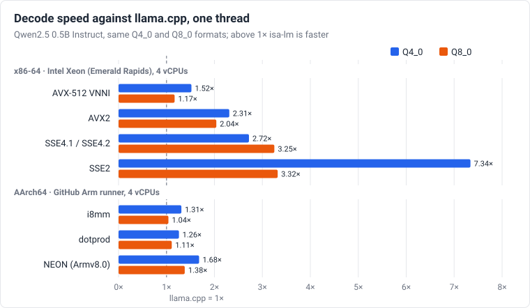

# Krafla
{: .fs-9 }

Portable INT8/INT4 LLM inference in C11 for CPUs without a GPU, from SSE2 and
ARMv7 NEON up to AVX-512 VNNI and SVE.
{: .fs-6 .fw-300 }

[Download a release](https://github.com/JonPark0/krafla/releases){: .btn .btn-primary .fs-5 .mb-4 .mb-md-0 .mr-2 }
[Get a converted model](user-guide.md#converted-models-on-hugging-face){: .btn .fs-5 .mb-4 .mb-md-0 .mr-2 }
[Quick start](#quick-start){: .btn .fs-5 .mb-4 .mb-md-0 }

---

**Krafla** (**K**ernels **R**etargeted **A**cross **F**amilies of **L**egacy **A**rchitectures, formerly
isa-lm) is a dependency-free **C11 inference runtime** for Llama-style **large language models** with
**INT8 and INT4 weights**. It runs on **x86-64 CPUs from SSE2 up to AVX-512 VNNI** and on **ARM CPUs from ARMv7
NEON up to i8mm and SVE**, including the legacy and low-power processors that GPU-first runtimes leave out.
The code is written against a portable baseline; you choose the instruction set when you compile, and every
operator is bound to the best kernel for it, with no runtime dispatch.

- **Faster decoding than llama.cpp** at every ISA level measured, on the same
  model and formats: 1.2–1.5× with AVX-512 VNNI, 1.0–2.3× with AVX2, 2.1–10×
  with SSE2 and SSE4.1, 1.04–1.7× on AArch64 ([comparison](benchmarks.md)).
- **No AVX, GPU or libraries needed:** any x86-64 CPU (SSE2) and 32-bit ARMv7
  NEON boards, up to AVX-512 VNNI, i8mm and SVE; static binaries for each ISA.
- **Accurate Q4:** fitted block scales give Qwen2.5 0.5B Q4_0 perplexity 15.1
  against 15.8–15.9 for llama.cpp's Q4_0; Q8 matches an F32 reference, and the
  output is bit-identical for any thread count.
- **Models:** Llama 2/3, Mistral, Qwen2.5, Qwen3, SmolLM2, Gemma 2 and Gemma 3
  from Hugging Face safetensors, with their tokenizers and chat templates.

## Decode speed against llama.cpp



Same model (Qwen2.5 0.5B Instruct), same Q4_0 and Q8_0 formats, same machine
for both runtimes. Prefill, four threads and perplexity are in the
[comparison](benchmarks.md).

## Supported CPUs

Each build targets one instruction set; the release archives start the
fastest build your CPU supports, and a build run on a CPU without its ISA
exits with code 3 and names the missing feature.

| Build | Minimum CPU |
|-------|-------------|
| `sse2` | any x86-64 (Athlon 64, Core 2) |
| `sse41` | Penryn, Nehalem |
| `avx2` | Haswell, Zen |
| `avxvnni` | Alder Lake, Zen 5 |
| `avx512vnni` | Cascade Lake, Ice Lake, Zen 4 |
| `neon` | ARMv7 with NEON, any AArch64 (Raspberry Pi 2 to 4) |
| `neon_dotprod` | Cortex-A55/A76 (Raspberry Pi 5), Apple M1 |
| `neon_i8mm` | Cortex-A710, Neoverse N2/V1, Apple M2 |
| `sve` | Neoverse V1/N2, Graviton 3 |
| `scalar` | any CPU with a C11 compiler |

Linux release archives cover x86-64, AArch64 and ARMv7; the Windows archive
covers x86-64. The Raspberry Pi boards are matched by ISA and have not been
measured yet.

## Quick start

With a [release](https://github.com/JonPark0/krafla/releases) and a
[converted model](user-guide.md#converted-models-on-hugging-face), no Python
is needed:

```sh
# in the unpacked release
curl -LO https://huggingface.co/jonpark0/Qwen2.5-0.5B-Instruct-krafla/resolve/main/Qwen2.5-0.5B-Instruct-Q4_0.mlb
curl -LO https://huggingface.co/jonpark0/Qwen2.5-0.5B-Instruct-krafla/resolve/main/tokenizer.mlt
./ml_run Qwen2.5-0.5B-Instruct-Q4_0.mlb -z tokenizer.mlt --chat qwen -t 4
```

Converted models: SmolLM2 135M and 360M, Qwen2.5 0.5B and 1.5B, Qwen3 0.6B
and TinyLlama 1.1B, in Q4_0, Q8_0 and mixed files. From source, with any
supported Hugging Face model:

```sh
make ISA=avx2                                    # or sse2, neon, neon_dotprod, sve, ...
python3 tools/convert.py hf ./Llama-3.2-1B-Instruct llama.mlb --wtype q4 --q8 v,o,down
python3 tools/convert_tokenizer.py ./Llama-3.2-1B-Instruct/tokenizer.json llama.mlt
build/avx2/ml_run llama.mlb -z llama.mlt --chat llama3 -t 4
```

The [user guide](user-guide.md) covers building, cross builds, conversion and
every option; the [FAQ](faq.md) answers the common questions.

## Features

- **Instruction sets:** scalar, SSE2, SSE4.1, AVX2, AVX-VNNI, AVX-512 VNNI, ARMv7/AArch64 NEON, NEON dotprod,
  i8mm (`smmla`), SVE (any vector length); a CPU guard refuses unsupported processors instead of crashing
- **Quantization:** Q8_0, Q4_0 with f16 block scales, and mixed models that keep chosen matrices in Q8; optional
  F16 or Q8 KV cache
- **Speed:** row-interleaved weight packing for each ISA's integer dot products, batched prompt prefill,
  software prefetch, blocked GQA attention, a thread pool with bit-identical results, a pack cache for fast start-up
- **Models:** llama2.c checkpoints and Hugging Face safetensors (Llama 2, Llama 3/3.1/3.2, TinyLlama, SmolLM2,
  Mistral, Qwen2/2.5, Qwen3, Gemma 2, Gemma 3 1B-27B text; llama3, linear and yarn RoPE scaling; per-layer
  sliding windows; logit soft-capping), Hugging Face `tokenizer.json`
  (SentencePiece-style including Gemma's, Llama 3, Qwen and GPT-2 byte-level BPE, identical to the `tokenizers` library)
- **Use:** text generation, chat mode (`llama3`, `zephyr`, `llama2`, `qwen`, `smollm`, `chatml`, `gemma` templates), top-k /
  top-p / repetition penalty, perplexity measurement, importance matrices for Q4
- **Verification:** kernel tests against scalar and double-precision references, end-to-end logits against a
  numpy reference, qemu for ARM and old x86 CPUs, native Arm CI

## Citing

```bibtex
@software{krafla2026,
  author  = {Park, Yeochoon},
  title   = {Krafla: a portable C11 runtime for INT8/INT4 Llama-style language model inference on legacy x86-64 and ARM instruction sets},
  year    = {2026},
  version = {0.5.0},
  url     = {https://github.com/JonPark0/krafla}
}
```

Source code: <https://github.com/JonPark0/krafla> · License: MIT
